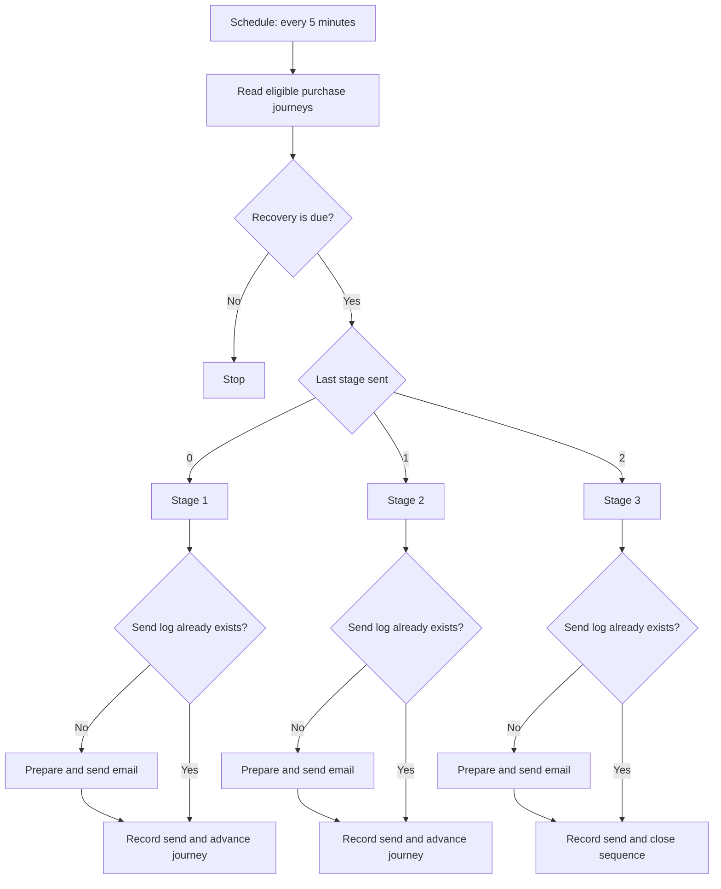

# Hotmart Recovery Engine — Portfolio Edition

[Português (Brasil)](README.pt-BR.md) · English

> A publication-safe, isolated edition of an automated purchase-recovery system. The live project was not edited, restarted, redeployed, queried, or connected to while this repository was prepared.

## What this project demonstrates

The verified workflow periodically finds eligible purchase journeys, checks whether the next recovery action is due, selects one of three follow-up stages, prevents duplicate sends for the same journey/flow/stage, prepares a status-aware message, sends it through Gmail, records the delivery, and advances the journey state in Supabase.

A read-only Next.js dashboard makes the event, journey, email, and recovery metrics understandable. The public dashboard runs with synthetic data by default and makes no external request.


**Live synthetic demo:** [Open the public dashboard](https://igor-marques-hotmart-recovery-demo.igormarques457.chatgpt.site)

## Verified scope

The available source artifacts support these claims:

- 22-node n8n recovery workflow;
- scheduled execution every five minutes;
- three recovery stages;
- eligibility and due-time checks;
- branching by current stage;
- a lookup that prevents a repeated send for the same journey, flow, and stage;
- message variants for `ABANDONED`, `WAITING_PAYMENT`, `CANCELED`, `DELAYED`, and `EXPIRED` flows;
- Gmail delivery nodes;
- Supabase reads and writes against `purchase_journeys` and `recovery_email_logs`;
- read-only dashboard views over `purchase_journeys`, `recovery_email_logs`, and `hotmart_events`;
- recovery, revenue, stage, flow, email, event, and journey views;
- no fabricated email open, click, or CTR metrics.

The supplied artifacts did **not** contain the upstream Hotmart ingestion workflow, database migrations/RLS policies, Postman/Newman collections, QA reports, or Railway configuration. They are not presented as verified public artifacts.

## Safe public edition

| Artifact | Publication state |
|---|---|
| n8n workflow | Included; inactive, all 22 nodes disabled, credentials removed, original UUIDs replaced |
| Dashboard | Included; synthetic demo mode enabled by default, no external calls required |
| Environment template | Included; placeholders only, external credentials empty |
| Customer and production data | Not included |
| Production URLs, tokens, keys, credential references | Not included in the supplied copy or public edition |
| Architecture | Updated from the reviewed workflow and dashboard source |
| Database schema/migrations | Not supplied; no SQL schema was invented |
| Postman/Newman and Railway artifacts | Not supplied; excluded from verified claims |
| Business-result metrics | Not supplied; synthetic demo values are clearly labelled and are not outcomes |

## Architecture


The dashed upstream ingestion path is contextually required by the dashboard’s `hotmart_events` data, but its implementation was not included. Everything inside the public repository is safe-by-default and isolated. See [architecture notes](docs/ARCHITECTURE.md).

## Recovery flow



## Repository structure

```text
.
├── assets/                     # Reviewed architecture diagram
├── dashboard/                  # Next.js portfolio demo with synthetic data
├── database/                   # Evidence boundary; no schema was supplied
├── demo/                       # Recording guidance and future reviewed media
├── docs/
│   ├── ARCHITECTURE.md         # Evidence-backed architecture notes
│   ├── DEMO_SCRIPT.md          # 60–90 second bilingual demo script
│   ├── FACTS_AND_GAPS.md       # Claims/evidence register
│   ├── PORTFOLIO_CASE.md       # Ready-to-adapt bilingual case study
│   ├── LINKEDIN_CONTENT.md     # Bilingual launch and follow-up posts
│   └── SECURITY_CHECKLIST*.md  # English and Portuguese release gates
├── tests/                      # Explicit record of missing QA artifacts
├── tools/prepublish-check.ps1  # Common secret-leak guard
├── workflows/
│   └── hotmart-recovery-engine.sanitized.json
├── .env.example                # Repository-level test-only placeholders
└── README.pt-BR.md
```

## Run the synthetic dashboard

The dashboard is safe-by-default: `PORTFOLIO_DEMO_MODE=true` uses only records declared in `dashboard/lib/demo-data.ts`.

```powershell
cd dashboard
Copy-Item .env.example .env.local
npm install
npm run dev
```

Open `http://localhost:3000`. The visible banner confirms that the data is synthetic and no external connection is active.

You can also use the [hosted public demo](https://igor-marques-hotmart-recovery-demo.igormarques457.chatgpt.site), which is permanently locked to synthetic data and has no Supabase or Gmail integration.

Never set `PORTFOLIO_DEMO_MODE=false` in a public deployment. The external-data path remains only as an architecture reference and must be used exclusively with a dedicated sandbox after a separate security review.

## Inspect the workflow safely

Import [`workflows/hotmart-recovery-engine.sanitized.json`](workflows/hotmart-recovery-engine.sanitized.json) only into a disposable n8n instance. The workflow and every node are disabled. Do not attach credentials or enable nodes unless all endpoints and accounts are isolated test resources.

## Security gate

Run the local guard:

```powershell
powershell -ExecutionPolicy Bypass -File .\tools\prepublish-check.ps1
```

Then complete the [public-release security checklist](docs/SECURITY_CHECKLIST.md). The script supplements manual review; it does not replace Git-history scanning, credential rotation, privacy review, or owner approval.

## Results policy

The dashboard’s demo values are fictional. No revenue, conversion, time-saved, uptime, test-count, or pass-rate claim should be published until an authorized measurement source is provided. The current evidence demonstrates architecture and implementation behavior—not business impact.

## License

No license has been selected. Confirm ownership and redistribution rights for every artifact before choosing one.
