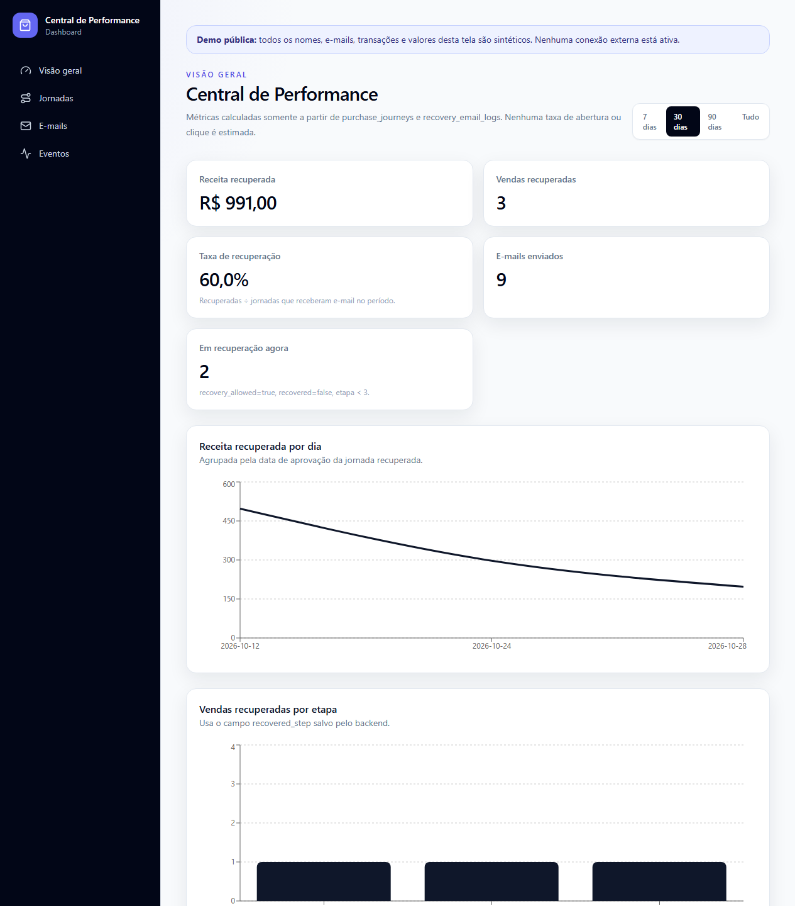
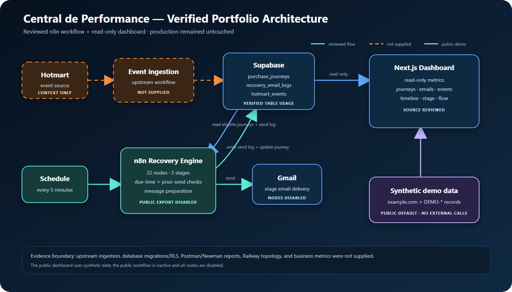
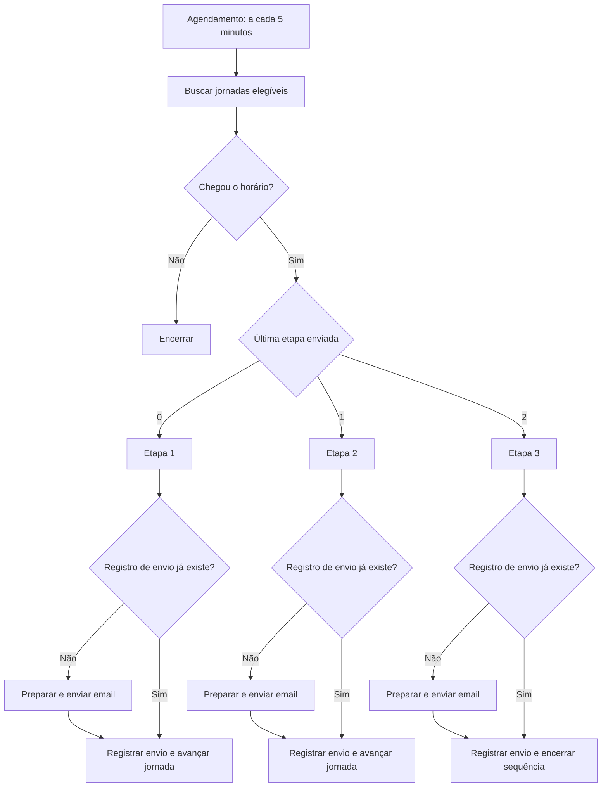

# Central de Performance — Edição de Portfólio

Português (Brasil) · [English](README.md)

> Versão isolada e segura para publicação da Central de Performance, um sistema automatizado de recuperação de compras e visibilidade operacional integrado aos eventos da Hotmart. O projeto em execução não foi editado, reiniciado, republicado, consultado nem conectado durante a preparação deste repositório.

## O que este projeto demonstra

O workflow verificado procura periodicamente jornadas elegíveis, confere se a próxima recuperação já deve acontecer, seleciona uma das três etapas de follow-up, evita repetir o mesmo envio para a combinação jornada/fluxo/etapa, prepara uma mensagem de acordo com o status, envia pelo Gmail, registra o envio e avança o estado da jornada no Supabase.

Um dashboard Next.js somente de leitura torna visíveis os eventos, jornadas, emails e métricas de recuperação. A versão pública abre com dados sintéticos e, por padrão, não faz nenhuma chamada externa.



**Demo sintética online:** [Abra o dashboard público](https://igor-marques-hotmart-recovery-demo.igormarques457.chatgpt.site)

## Escopo comprovado

Os arquivos encontrados comprovam:

- workflow n8n com 22 nodes;
- execução agendada a cada cinco minutos;
- três etapas de recuperação;
- verificação de elegibilidade e horário;
- ramificação pela última etapa enviada;
- busca que evita novo envio para a mesma jornada, fluxo e etapa;
- mensagens diferentes para os fluxos `ABANDONED`, `WAITING_PAYMENT`, `CANCELED`, `DELAYED` e `EXPIRED`;
- envio por nodes do Gmail;
- leitura e escrita no Supabase nas tabelas `purchase_journeys` e `recovery_email_logs`;
- dashboard somente leitura sobre `purchase_journeys`, `recovery_email_logs` e `hotmart_events`;
- telas de recuperação, receita, etapas, fluxos, emails, eventos e jornadas;
- ausência intencional de métricas inventadas de abertura, clique ou CTR.

Os arquivos fornecidos **não** continham o workflow anterior que recebe eventos da Hotmart, migrations/policies RLS do banco, collections Postman/Newman, relatórios de QA ou configuração do Railway. Esses itens não são apresentados como artefatos públicos comprovados.

## Segurança da edição pública

| Artefato | Situação para publicação |
|---|---|
| Workflow n8n | Incluído; inativo, 22 nodes desativados, sem credenciais e com UUIDs originais substituídos |
| Dashboard | Incluído; modo sintético ativado por padrão e sem necessidade de chamadas externas |
| Exemplo de ambiente | Incluído; apenas placeholders e credenciais externas vazias |
| Dados de clientes e produção | Não incluídos |
| URLs, tokens, chaves e referências de credenciais | Não encontrados na cópia fornecida nem incluídos na edição pública |
| Arquitetura | Atualizada a partir do workflow e do código do dashboard |
| Schema/migrations do banco | Não fornecidos; nenhum SQL foi inventado |
| Postman/Newman e Railway | Não fornecidos; excluídos das afirmações comprovadas |
| Métricas de negócio | Não fornecidas; números da demo são sintéticos e não representam resultados |

## Arquitetura



O caminho tracejado de ingestão é necessário para explicar os dados de `hotmart_events`, mas sua implementação não veio nos arquivos. Tudo que está neste repositório público é seguro por padrão e isolado. Veja as [notas de arquitetura](docs/ARCHITECTURE.md).

## Fluxo de recuperação



## Estrutura do repositório

```text
.
├── assets/                     # Diagrama de arquitetura revisado
├── dashboard/                  # Demo Next.js com dados sintéticos
├── database/                   # Limite da evidência; schema não fornecido
├── demo/                       # Orientações para gravação e futuras mídias
├── docs/
│   ├── ARCHITECTURE.md         # Arquitetura baseada em evidência
│   ├── DEMO_SCRIPT.md          # Roteiro bilíngue de 60–90 segundos
│   ├── FACTS_AND_GAPS.md       # Registro de fatos e lacunas
│   ├── PORTFOLIO_CASE.md       # Case bilíngue pronto para adaptação
│   ├── LINKEDIN_CONTENT.md     # Lançamento e série de posts
│   └── SECURITY_CHECKLIST*.md  # Barreiras de publicação em PT e EN
├── tests/                      # Registro explícito dos artefatos de QA ausentes
├── tools/prepublish-check.ps1  # Verificador contra vazamentos comuns
├── workflows/
│   └── hotmart-recovery-engine.sanitized.json
├── .env.example                # Placeholders de teste do repositório
└── README.md                   # README em inglês
```

## Executar o dashboard sintético

O dashboard é seguro por padrão: `PORTFOLIO_DEMO_MODE=true` usa somente os registros declarados em `dashboard/lib/demo-data.ts`.

```powershell
cd dashboard
Copy-Item .env.example .env.local
npm install
npm run dev
```

Abra `http://localhost:3000`. Um aviso visível confirma que os dados são sintéticos e que nenhuma conexão externa está ativa.

Você também pode usar a [demo pública hospedada](https://igor-marques-hotmart-recovery-demo.igormarques457.chatgpt.site), que fica permanentemente limitada a dados sintéticos e não possui integração com Supabase ou Gmail.

Nunca configure `PORTFOLIO_DEMO_MODE=false` em um deploy público. O caminho de dados externos permanece apenas como referência de arquitetura e só deve ser usado com sandbox dedicada após outra revisão de segurança.

## Inspecionar o workflow com segurança

Importe [`workflows/hotmart-recovery-engine.sanitized.json`](workflows/hotmart-recovery-engine.sanitized.json) somente em uma instância descartável do n8n. O workflow e todos os nodes estão desativados. Não vincule credenciais nem ative nodes enquanto endpoints e contas não forem recursos isolados de teste.

## Barreira de segurança

Execute o verificador local:

```powershell
powershell -ExecutionPolicy Bypass -File .\tools\prepublish-check.ps1
```

Depois conclua o [checklist de publicação em português](docs/SECURITY_CHECKLIST.pt-BR.md). O script complementa a revisão manual; ele não substitui análise do histórico Git, troca de credenciais, revisão de privacidade ou aprovação do proprietário.

## Política de resultados

Os valores do dashboard são fictícios. Nenhuma afirmação sobre receita, conversão, tempo economizado, disponibilidade, quantidade de testes ou taxa de aprovação deve ser publicada sem uma fonte autorizada. A evidência atual demonstra arquitetura e comportamento da implementação, não impacto financeiro.

## Licença

Nenhuma licença foi escolhida. Confirme a propriedade e os direitos de redistribuição de cada artefato antes de selecionar uma.
