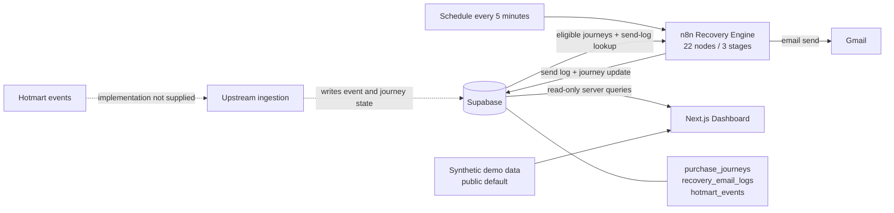

# Verified architecture / Arquitetura verificada

## Evidence boundary / Limite da evidência

This document is based on two supplied artifacts: a disabled 22-node n8n workflow export and the source of a read-only Next.js dashboard. No production system was queried. The upstream Hotmart event-ingestion workflow, database migrations/RLS, Postman/Newman tests, QA reports, and Railway configuration were not supplied.

Este documento usa dois artefatos fornecidos: um export inativo de 22 nodes do n8n e o código de um dashboard Next.js somente leitura. Nenhum sistema de produção foi consultado. O workflow anterior de ingestão Hotmart, migrations/RLS, testes Postman/Newman, relatórios de QA e configuração Railway não foram fornecidos.

## System view / Visão do sistema

## Verified recovery sequence / Sequência comprovada

1. A schedule trigger runs every five minutes.
2. The workflow reads `purchase_journeys` where recovery is allowed, the journey is not recovered, and fewer than three stages were sent.
3. A due-time condition compares `next_step_at` with the current time.
4. A switch selects stage 1, 2, or 3 from `last_step_sent`.
5. Before each stage, the workflow queries `recovery_email_logs` for the same `journey_id`, `recovery_flow`, and `step`.
6. If a matching log is absent, the workflow creates a status-aware subject/body and calls Gmail.
7. It writes a `SENT` log with the message ID and timestamp.
8. It updates `last_step_sent`, `updated_at`, and the next execution time. Stage 3 clears `next_step_at`.

## Dashboard behavior / Comportamento do dashboard

- Server-side pagination reads up to 1,000 rows at a time.
- Metrics are calculated from `purchase_journeys` and `recovery_email_logs`.
- Recovery flow is inferred from the latest `SENT` log before approval when the journey no longer stores the flow.
- The event view reads `hotmart_events` and exposes processing status/errors.
- Auth uses Supabase Auth with an email allowlist when external-data mode is enabled.
- The public edition defaults to `PORTFOLIO_DEMO_MODE=true`, bypasses authentication, and uses only synthetic in-repository data.
- Email open, click, and CTR metrics are intentionally absent because the reviewed backend does not record them.

## Public safety transformations / Transformações de segurança

| Original copy | Portfolio edition |
|---|---|
| Inactive workflow with original UUIDs | Inactive workflow, all nodes disabled, UUIDs regenerated |
| Credential slots empty | Credential fields removed |
| Dashboard expects Supabase | Synthetic demo is the default and external values are empty |
| Potential display of customer fields | Only `example.com` identities and `DEMO-*` identifiers |
| Production/result context unavailable | No production metric is claimed |

## Not represented as verified / Não apresentado como comprovado

- Exact Hotmart webhook verification and ingestion logic
- Database column constraints, indexes, triggers, functions, and RLS policies
- Gmail OAuth configuration
- Railway deployment topology
- Postman/Newman scenario count or results
- Error retry policy outside the supplied recovery workflow
- Production volume, latency, uptime, revenue, or conversion impact

